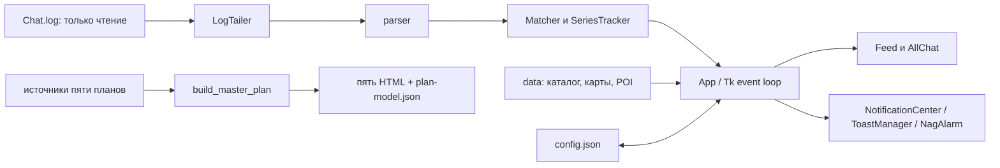

# Технический контекст для архитектурного анализа

## Модули и границы

Это ориентир, не неизменная схема: перед ADR сверяй реальные вызовы. `main.py` создаёт Tk; `watcher/app.py` связывает UI, опрос лога, карту и уведомления. `allchat.py` имеет отдельное чтение лога при активной вкладке. `notify_center.py` — ядро без окон; `toasts.py` — адаптер Tk/Windows. `mapview.py` и `poi.py` соединяют карты с клиентскими координатами. `tools/` готовят данные и планы; `client_extract/` и `downloads/` не входят в exe.

## Вопросы для каждого решения

1. Где единственный владелец состояния, кто сохраняет и восстанавливает его после перезапуска?
2. Что будет при частичном файле, недоступном Chat.log, повторном старте, закрытии окна во время таймера, длительной работе?
3. Сохраняется ли чтение игровой папки без записи и совместимость текущего `config.json`?
4. Не дублируется ли уже существующая очередь, таймер, парсер, генератор или каталог?
5. Чем можно измерить результат, где тест, как откатиться без потери пользовательских данных?

## Минимальный ADR

`Статус: предложено Claude / принято Claude; Контекст; Решение; Альтернативы (минимум 2 для значимого изменения); Последствия и риски; Изменяемые файлы и контракты; Пошаговая миграция; Проверка и откат`. Ссылку на ADR ставь в `docs/PROJECT_ARCHITECTURE.md` и соответствующий план после принятия. Малые локальные исправления описывай в `PAIR.md`, отдельный ADR им не нужен.
