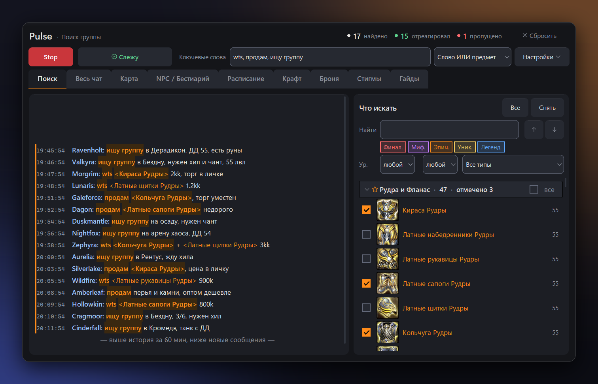
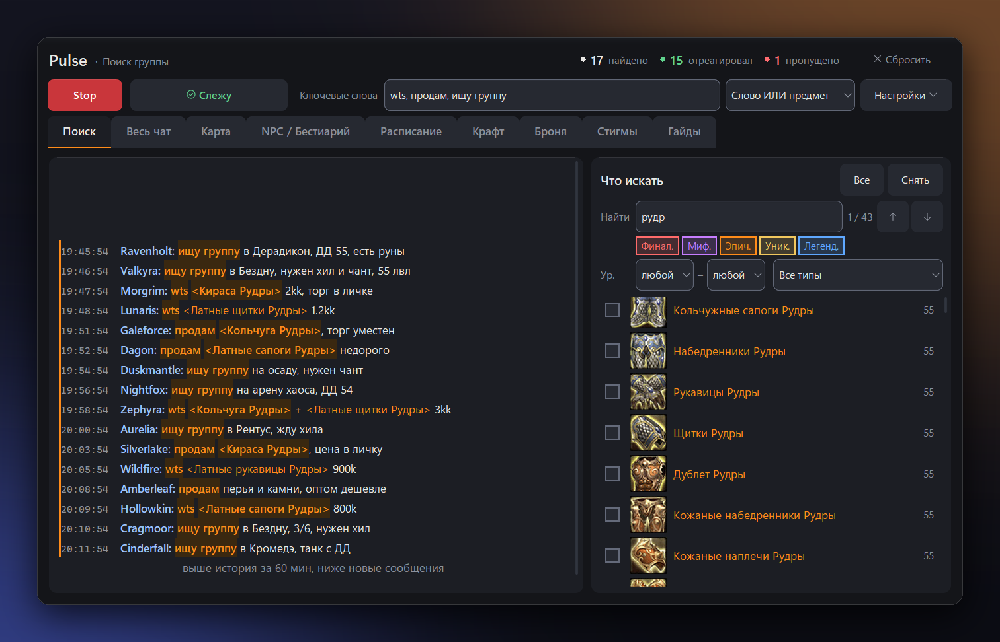
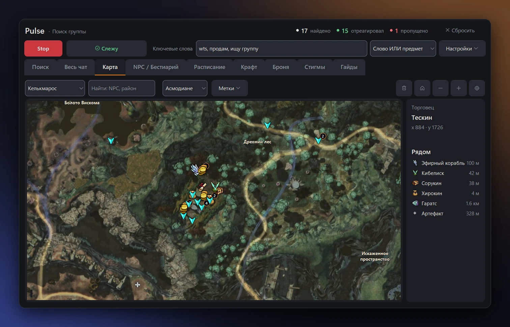
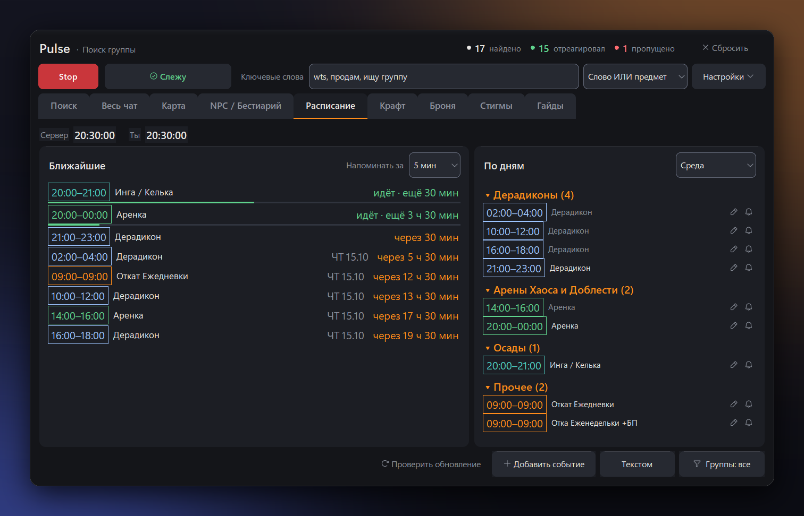
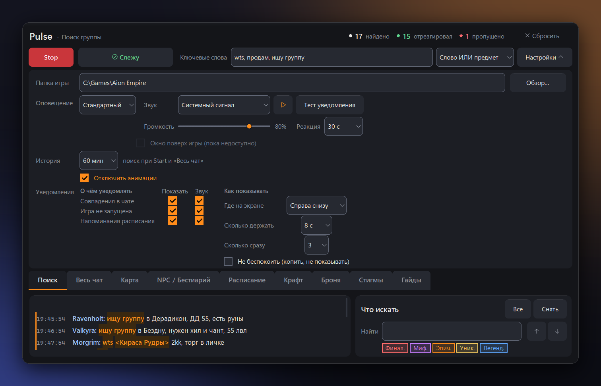

<h1 align="center">⚡ Pulse</h1>

<p align="center">
  <b>Помощник для Aion Empire: следит за чатом и зовёт, когда найдено то, что нужно тебе</b>
</p>

<p align="center">
  <a href="https://github.com/yshu17/aion-pulse/releases/latest">
    
  </a>
</p>

<p align="center">
  
  
  
</p>

<p align="center">
  <a href="README_FULL.md">📖 Полная версия</a> ·
  <a href="https://github.com/yshu17/aion-pulse/releases">📦 Релизы</a> ·
  <a href="README_FULL.md#%EF%B8%8F-configjson">⚙️ config.json</a>
</p>

<p align="center">
  
</p>

## ✨ Возможности

- 🔔 **Поиск** — сигнал, когда в «Поиске группы» появилось ключевое слово или ссылка на отмеченный предмет
- 🎒 **Что искать** — 11 тыс. предметов с 45-го уровня: иконки, цвет по качеству, фильтры и подсказки с характеристиками
- 💬 **Весь чат** — все каналы в одном окне, ссылки на предметы, места и задания читаются названиями
- 🗺️ **Карта** — оригинальные карты игры: привратники, склады, торговцы, NPC с заданиями
- 📅 **Расписание** — события сервера в твоём времени и напоминания
- 🛡️ **Безопасно** — Pulse только читает `Chat.log`; клиент, память игры и ввод не трогаются

## 🚀 Быстрый старт

1. Скачай [Pulse.exe](https://github.com/yshu17/aion-pulse/releases/latest) и запусти.
2. В `system.cfg` игры включи лог чата: `g_chatlog = "1"`.
3. В **Настройки** укажи **Папку игры** (`Aion Empire`).
4. Введи **Ключевые слова** или отметь предметы в **Что искать**.
5. Нажми **Start** — статус сменится на «● Слежу».

## 📸 Скриншоты

| 🎒 Что искать | 🗺️ Карта |
|:---:|:---:|
|  |  |
| **📅 Расписание** | **⚙️ Настройки** |
|  |  |

## 🛠️ Из исходников

```
pip install -r requirements.txt
python main.py
```

---

<p align="center">
  Режимы оповещения, фильтры, карта, <code>config.json</code>, данные и разработка —
  в <a href="README_FULL.md"><b>📖 полной версии</b></a>.
</p>
