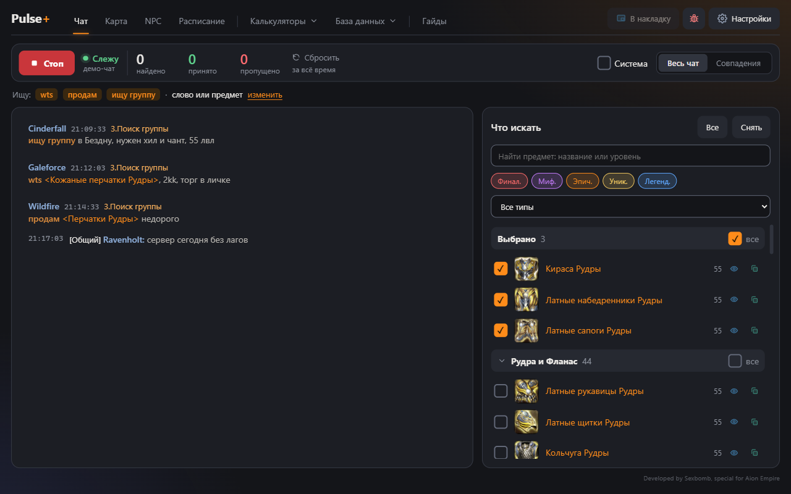
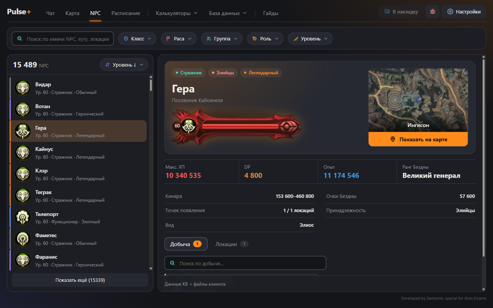
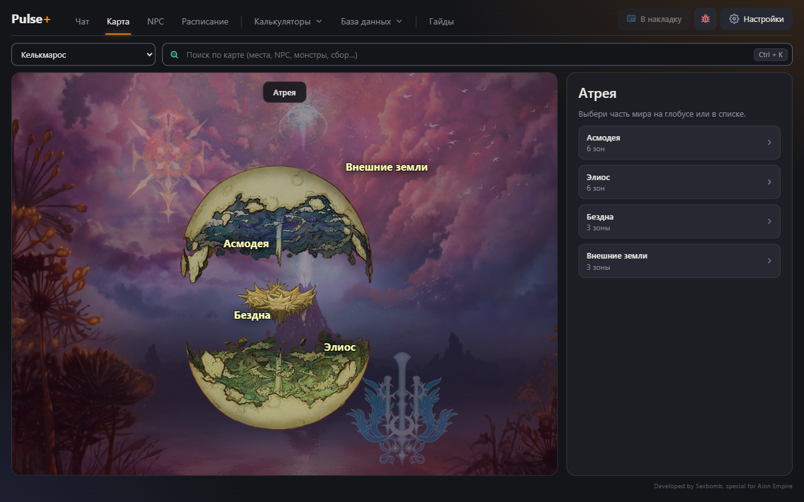
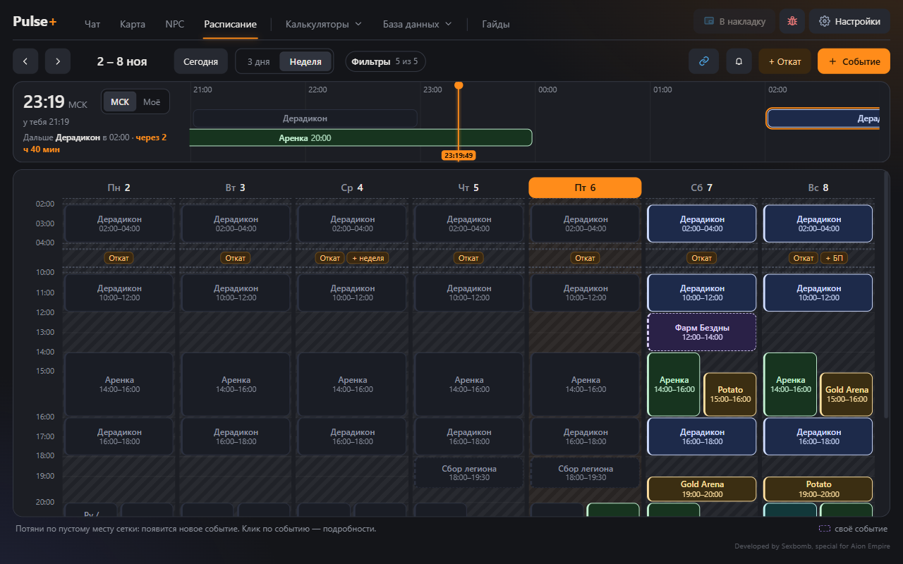
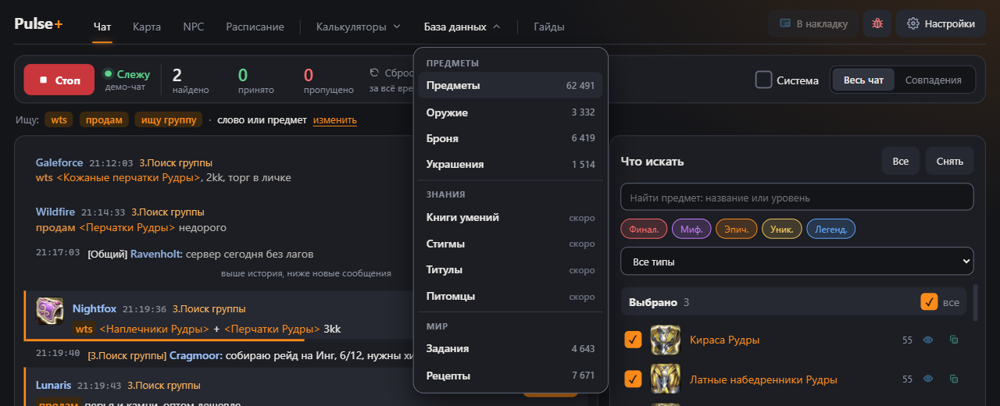
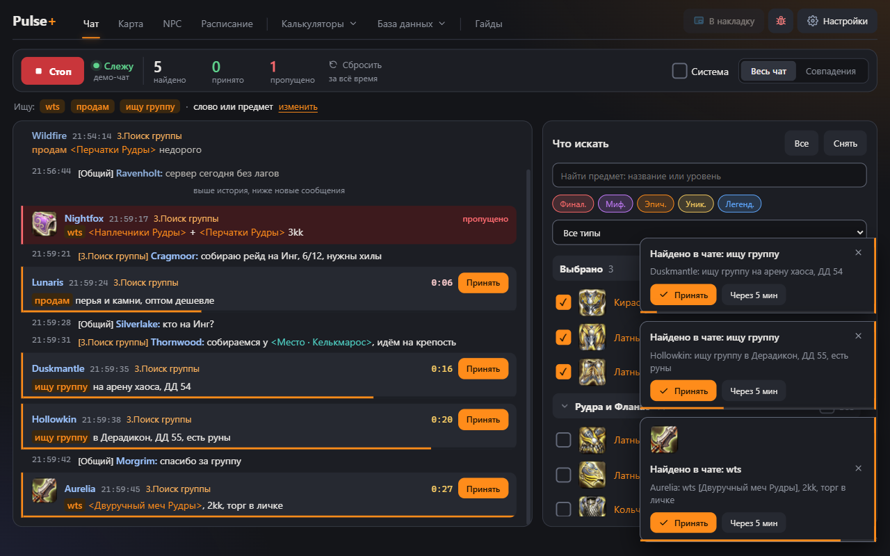
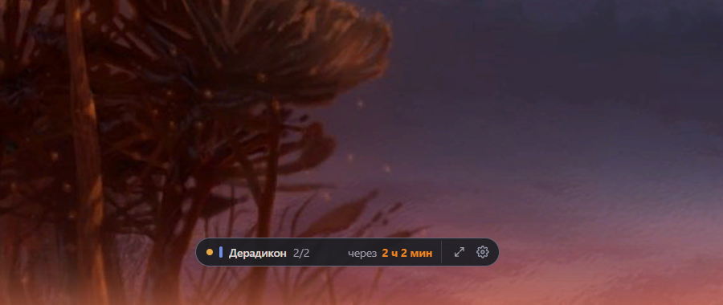

<h1 align="center">⚡ Pulse+</h1>

<p align="center">
  <b>Помощник для Aion Empire: чат, карта, бестиарий и расписание в одном окне</b><br>
  <sub>Зовёт, когда в чате ищут то, что нужно тебе, и знает, где найти любого NPC</sub>
</p>

<p align="center">
  <a href="https://github.com/yshu17/aion-pulse/releases">
    
  </a>
</p>

<p align="center">
  
  
  
  
</p>

<p align="center">
  <a href="https://github.com/yshu17/aion-pulse/releases">📦 Релизы</a> ·
  <a href="README_FULL.md">📖 Прежняя версия (Python)</a>
</p>

<p align="center">
  <sub>Все данные (предметы, NPC, карты, задания, рецепты) взяты из открытых источников: сайта Aion Empire и распаковки клиента игры сервера. Описания и прохождения заданий — с <a href="https://aidb.ru">aidb.ru</a>, базовые характеристики классов для калькулятора — с <a href="https://aiongear.fun">aiongear.fun</a>. Данные актуальны для версий игры 2.0–3.0.</sub>
</p>

<p align="center">
  
</p>

## ✨ Что внутри

- 🔔 **Чат** — сигнал, когда в «Поиске группы» появилось ключевое слово или ссылка на отмеченный предмет; весь чат в одном окне, ссылки на предметы, места и задания читаются названиями
- 🎒 **Что искать** — каталог предметов с иконками, цветом по качеству, фильтрами и подсказками с характеристиками
- 🗺️ **Карта** — оригинальные карты игры, поиск по местам, NPC, монстрам и сбору (`Ctrl + K`), метки привратников, складов, торговцев, подземелий
- 👤 **NPC** — 15 489 NPC и монстров: фильтры по классу, расе, группе, роли и уровню; карточка с добычей, товарами, локациями и кнопкой «Показать на карте»
- 📅 **Расписание** — события сервера в твоём времени, откаты, напоминания и свои события
- 🗃️ **База данных** `beta` — 10 разделов: предметы, оружие, броня, украшения, книги умений, стигмы, титулы, питомцы, задания и рецепты. Поиск, фильтры, игровая карточка предмета, где он падает, как создаётся и у кого продаётся, сравнение двух предметов; у задания — кто выдаёт, шаги прохождения и награда; у рецепта — из чего создаётся
- ⚔️ **Калькуляторы → Экипировка** `beta` — калькулятор снаряжения для версии 2.0: класс и уровень, предметы, заточка, магические камни, сеты, свитки, баффы и титул, до четырёх наборов и их сравнение
- 🪟 **В накладку** — окно прячется, поверх игры остаются полоса и уведомления
- 🧭 **Вкладки помнят выбор** — ушёл с карты в чат и вернулся: всё на месте
- 🔄 **Обновления** — Pulse+ сам находит новую версию, после твоего «Обновить сейчас» скачивает её, проверяет контрольную сумму SHA-256 и перезапускается

## 🚀 Быстрый старт

1. Скачай `Pulse+.exe` со страницы [Релизы](https://github.com/yshu17/aion-pulse/releases) и запусти. Установка не нужна.
2. В `system.cfg` игры включи лог чата: `g_chatlog = "1"`.
3. В **Настройки** укажи **Папку игры** (`Aion Empire`).
4. Введи **Ключевые слова** или отметь предметы в **Что искать**.
5. Нажми **Старт**. Статус сменится на «Слежу».

> Нужен Windows 10 или 11 с WebView2 (есть в системе по умолчанию).

## 📸 Скриншоты

| 👤 NPC | 🗺️ Карта |
|:---:|:---:|
|  |  |
| **📅 Расписание** | **🗃️ База данных** |
|  |  |

### 🔔 Уведомления и накладка

Найденное в чате приходит уведомлением с кнопками «Принять» и «Через 5 мин». Кнопка **В накладку** сворачивает окно: поверх игры остаётся полоса с ближайшим событием, а уведомления всплывают над ней.

<p align="center">
  
</p>

<p align="center">
  
</p>

## 🛡️ Безопасность

Pulse+ только читает `Chat.log`. Он не трогает клиент игры, её память и ввод. Окно проверяет, запущена ли игра, и больше ничего с ней не делает.

## 🧭 Скоро

В меню уже стоят разделы-заготовки, они наполнятся в следующих версиях:

- 🔨 **Крафт** — из чего создаётся предмет, профессия и уровень мастерства
- ✨ **Стигмы** — сборка стигм персонажа
- 📖 **Гайды** — классы, подземелья, боссы и события сервера

## ⚠️ Известные проблемы

### Знаки вопроса вместо текста в чате

В чате некоторые сообщения показываются со знаками вопроса `?` или символами `�` вместо букв: иногда в части строки, иногда целиком.

**Почему.** Pulse+ читает `Chat.log` как UTF-8. Если в логе встречаются байты, которые не складываются в UTF-8, программа заменяет их на символ замены. Вероятная причина в том, что игра пишет часть строк в другой кодировке. Текст в самом файле `Chat.log` при этом не портится, искажается только отображение.

**Что это значит.** Строка с искажённым текстом может не совпасть с ключевым словом, и сигнал не придёт.

**Решение.** Смени локацию (телепорт или выход в другую зону) либо перезагрузи клиент игры.

### Пропущенные сообщения на осадах

Во время осад игра не успевает записывать `Chat.log`, и Pulse+ не видит часть сообщений.

Решения пока нет.

## 🛠️ Из исходников

Нужны Node.js 20+, Rust (stable), Python 3.10+ и Windows с WebView2.

```powershell
git clone https://github.com/yshu17/aion-pulse.git
cd aion-pulse
cd launcher; npm install; cd ..
powershell -ExecutionPolicy Bypass -File tools\build_pulse_plus.ps1
```

Скрипт собирает базу `data/pulse.db` из файлов `data/` (её читают все вкладки), затем программу. Готовый `Pulse+Local.exe` лежит в `local\Pulse+Release`. Один файл для раздачи делает `tools\single_exe\build_single_exe.ps1`.

Разработка и проверки:

```powershell
cd launcher
npx tauri dev      # окно программы с горячей перезагрузкой
npm run dev        # только страница в браузере, http://localhost:1420
npm test           # тесты интерфейса и ядра
npx tsc --noEmit -p .
cd ..
python -m pytest   # тесты сборки базы и данных
```

## 🗂️ Устройство

| Папка | Что там |
|---|---|
| `launcher/` | программа: Tauri 2 (Rust) + React + TypeScript |
| `launcher/src/core/` | ядро без интерфейса: вкладки, поиск, запросы к базе, расписание |
| `core/pulse_db/` | сборка одной базы `data/pulse.db` из данных игры |
| `data/` | иконки, карты, данные игры |
| `tools/` | сборка, выгрузка данных из клиента, упаковка в один exe |

## ♻️ Прежняя версия

Первая версия Pulse (Python и Tkinter, релизы 1.x) осталась в ветке [`feat/chat-watcher`](https://github.com/yshu17/aion-pulse/tree/feat/chat-watcher) и в старых релизах. Её описание: [README_FULL.md](README_FULL.md).

---

<p align="center">
  Developed by Sexbomb, special for Aion Empire
</p>
