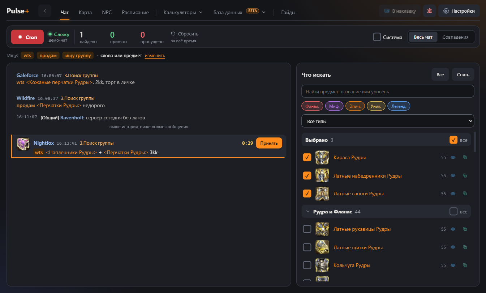
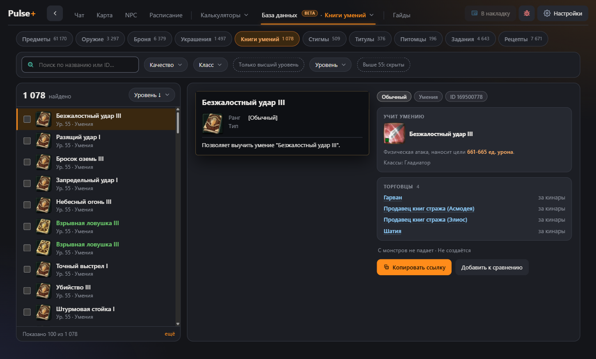
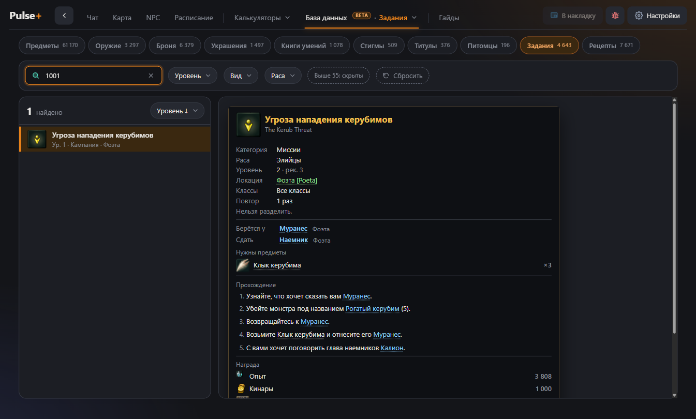
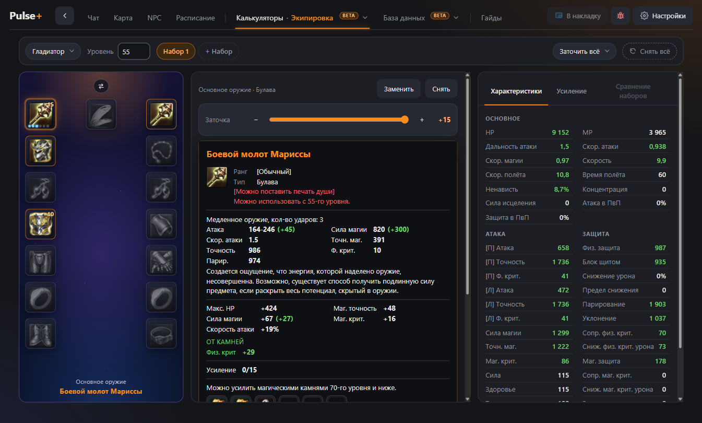
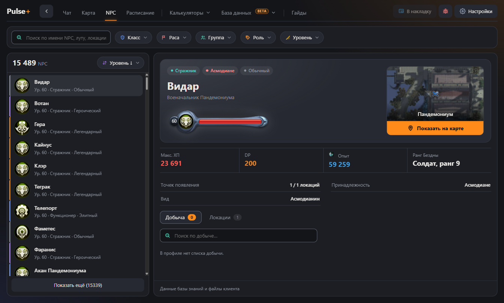
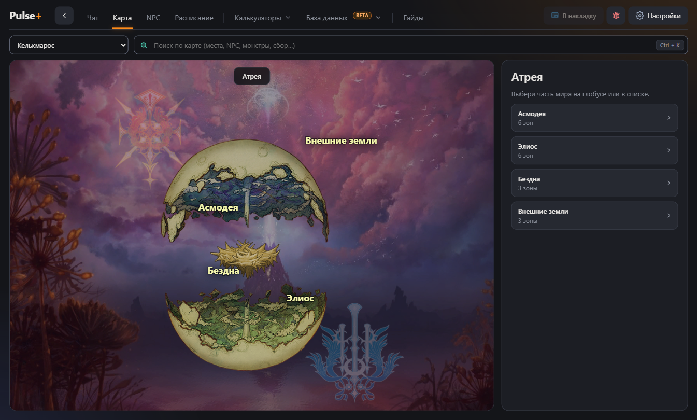
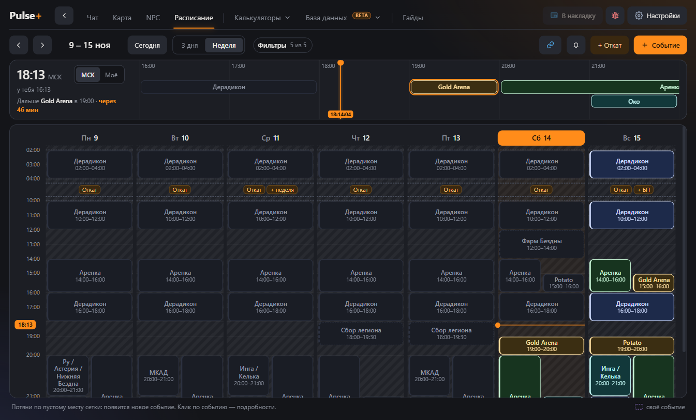

<h1 align="center">Pulse+</h1>

<p align="center">
  <b>Помощник для Aion Empire: следит за чатом, показывает карту, базу данных игры и считает экипировку</b>
</p>

<p align="center">
  <a href="https://github.com/yshu17/aion-pulse/releases/latest">
    
  </a>
</p>

<p align="center">
  
  
  
</p>

<p align="center">
  
</p>

## Что умеет

**Чат.** Pulse+ читает файл `Chat.log` и подаёт сигнал, когда в канале «Поиск группы» появилось ваше ключевое слово или ссылка на отмеченный предмет. Совпадение приходит уведомлением со звуком и кнопкой «Принять». Весь чат можно читать в окне программы: ссылки на предметы, места и задания показываются названиями. Режим «В накладку» оставляет поверх игры только полосу и уведомления.

**Карта.** Оригинальные карты игры: привратники, склады, торговцы, NPC с заданиями, подземелья, места сбора. Поиск по местам, NPC и монстрам, свои метки.

**NPC.** Каталог NPC и монстров: уровень, где появляется, что продаёт, что роняет. Из любого места программы можно перейти к NPC по ссылке.

**База данных** (бета). Предметы, оружие, броня, украшения, книги умений, стигмы, титулы, питомцы, задания и рецепты: более 60 тысяч записей из клиента игры. Поиск и фильтры, карточка как в игре, где предмет падает и у кого продаётся, сравнение двух предметов. У задания: кто выдаёт и сдаёт, прохождение по шагам, награда; предметы, NPC, локации и зависимые задания кликабельны. У книг и стигм виден урон каждого уровня.

**Экипировка** (бета, раздел «Калькуляторы»). Калькулятор снаряжения для версии 2.0: класс и уровень, предметы, заточка, магические камни, сеты, свитки, баффы, титулы. До четырёх наборов и их сравнение. Камни выбираются прямо в карточке предмета, прибавка от камней и заточки показывается в скобках рядом с цифрами. Расчёт сверен с aiongear.fun.

**Расписание.** События сервера в вашем времени, напоминания и свои события.

<table>
  <tr>
    <td width="50%"></td>
    <td width="50%"></td>
  </tr>
  <tr>
    <td></td>
    <td></td>
  </tr>
  <tr>
    <td></td>
    <td></td>
  </tr>
</table>

## Быстрый старт

1. Скачайте [`Pulse+.exe`](https://github.com/yshu17/aion-pulse/releases/latest) и запустите. Установки нет, нужен Windows 10 или 11.
2. В `system.cfg` игры включите лог чата: `g_chatlog = "1"`.
3. В **Настройках** укажите **Папку игры** (`Aion Empire`).
4. Введите **ключевые слова** или отметьте предметы в панели «Что искать».
5. Нажмите **Старт**: статус сменится на «Слежу».

При первом запуске программа один раз скачивает карты игры (около 140 МБ). При обновлении программы они заново не качаются.

## Обновления

- **Программа.** Pulse+ сам замечает новую версию, ставит её после вашего согласия и перед этим сверяет контрольную сумму SHA-256.
- **Данные игры.** База лежит отдельным пакетом (около 17 МБ). Когда на релизе `db-latest` появляется свежая, в шапке показывается кнопка «Обновить данные». Новый `Pulse+.exe` не нужен.
- Версия видна в заголовке окна.

## Безопасность

Pulse+ только читает `Chat.log`. Клиент игры, её память и ввод не затрагиваются, чужих процессов программа не трогает. Единственное, что она смотрит у системы: есть ли в списке процессов `aion.bin`, чтобы знать, запущена ли игра. Сеть нужна для обновлений, карт и пакета данных; все скачанные файлы проверяются по SHA-256, адреса ограничены релизами этого репозитория.

## Откуда данные

Предметы, NPC, задания, титулы и значки взяты из клиента игры. Описания и прохождения заданий и урон умений: [aidb.ru](https://aidb.ru/). Базовые характеристики классов для калькулятора: [aiongear.fun](https://aiongear.fun/). Карты мира взяты из клиента.

## Сборка из исходников

Нужны Node.js, Rust и Python 3.

```
cd launcher
npm install
npm run tauri dev
```

База игры собирается скриптом `python tools/build_pulse_db.py` (нужны выгрузка клиента и данные карт). Сборка программы: `tools/build_pulse_plus.ps1`, одним файлом: `tools/single_exe/build_single_exe.ps1`. Тесты: `python -m pytest tests`, `npm test` и `cargo test` в папке `launcher/src-tauri`.

Старая версия на Python и Tkinter осталась в ветке [`feat/chat-watcher`](https://github.com/yshu17/aion-pulse/tree/feat/chat-watcher) и в релизах 1.x.
