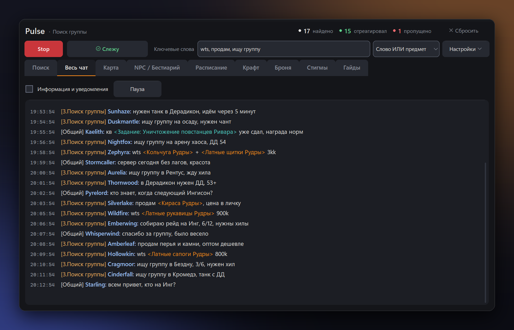

<h1 align="center">⚡ Pulse — полная версия</h1>

<p align="center">
  <a href="README.md">⬅️ Краткая версия</a> ·
  <a href="https://github.com/yshu17/aion-pulse/releases/latest">📦 Скачать Pulse.exe</a>
</p>

**Pulse** следит за чатом Aion в реальном времени и подаёт сигнал, когда в канале «Поиск группы»
появляется сообщение с одним из **Ключевых слов** или ссылка на предмет, отмеченный в **Что искать**.
Кроме слежения в нём есть каталог предметов, карта, расписание сервера и самообновление.

> 🛡️ Pulse только читает файл `Chat.log`. Клиент, память игры и ввод не трогаются.

## 📑 Содержание

- [⚙️ Как работает](#️-как-работает)
- [🔔 Поиск](#-поиск)
- [🎒 Что искать](#-что-искать)
- [📣 Оповещение](#-оповещение)
- [💬 Весь чат](#-весь-чат)
- [🗺️ Карта](#️-карта)
- [🐺 NPC / Бестиарий](#-npc--бестиарий)
- [📅 Расписание](#-расписание)
- [🧰 Настройки](#-настройки)
- [🔄 Обновления](#-обновления)
- [🧭 Скоро](#-скоро)
- [⚙️ config.json](#️-configjson)
- [🗃️ Данные](#️-данные)
- [👨‍💻 Разработка](#-разработка)

---

## ⚙️ Как работает

- Клиент пишет чат в `<Папка игры>\classic\Chat.log` — в `system.cfg` должно быть `g_chatlog = "1"`.
- Pulse читает только новые строки и берёт строки `[3.Поиск группы]`, в том числе с битой кодировкой
  названия канала (`[3.????? ??????]`).
- Ник и служебная разметка отбрасываются, Ключевые слова ищутся в тексте без учёта регистра, «ё» = «е».
- Ссылки на предметы (`[item:ID]`) заменяются названием из каталога kb.aionempire.com — поэтому
  Ключевое слово находит и названия предметов в ссылках.
- Один и тот же текст от того же игрока не звенит чаще раза в `cooldown_sec` секунд.

## 🔔 Поиск

<p align="center"></p>

Главная вкладка: лента совпадений слева, список **Что искать** справа. Счётчики «Найдено / Отреагировал /
Пропущено» видны в шапке на любой вкладке.

- ▶️ **Start / Stop** — сигналы только для новых сообщений после Start.
- 🔑 **Ключевые слова** — через запятую, применяются по Enter.
- 🎯 **Режим поиска** (справа от Ключевых слов):

  | Режим | Когда срабатывает |
  |---|---|
  | **Слово ИЛИ предмет** *(по умолчанию)* | совпало слово **или** ссылка на отмеченный предмет |
  | **Только слова** | галочки предметов не учитываются |
  | **Только предметы** | Ключевые слова не учитываются |
  | **Слово И предмет** | в одном сообщении и слово, и ссылка на отмеченный предмет |

  Если для режима чего-то не хватает, статус подскажет: «нет ключевых слов», «не отмечены предметы».
- 🕑 **История** (нет / 5 / 15 / 30 / 45 / 60 мин) — одна настройка для двух мест: при Start
  показывает совпадения за этот период (без оповещений), а **Весь чат** открывается с сообщениями за тот же период.
- 🎮 **Проверка игры** — без запущенного клиента (`aion.bin`) Start не включает слежение, а если игру
  закрыть во время слежения (проверка раз в 5 с), оно останавливается. В обоих случаях — сигнал,
  строка в ленте и «⚠ Игра не запущена». Отключается `game_check: false`.
- 📜 Лента прижата к низу, как игровой чат: новые сообщения внизу.
- ↔️ Ширину ленты и **Что искать** можно менять, перетаскивая промежуток между ними
  (запоминается в `items_width`); ни одна часть не становится уже исходной ширины списка.
- 📋 Копирование: выдели мышью и Ctrl+C (работает и на русской раскладке) или правый клик —
  «Копировать», «Копировать сообщение», «Выделить всё». Так же во **Весь чат**.

## 🎒 Что искать

<p align="center"></p>

- 📦 Вся броня, оружие, щиты и крылья с 45-го уровня — около 11 тыс. предметов с kb.aionempire.com.
  Белых и зелёных (common / rare) нет.
- 🎨 Иконки и цвет названия по качеству — как в игре. Наведи на иконку или название — подсказка с характеристиками.
- 🗂️ Секции: **★ Рудра и Фланас** (закреплена вверху), Лата, Кольчуга, Кожа, Ткань, Оружие, Щиты, Крылья.
  Внутри — от высокого уровня к низкому, сначала лучшее качество.
  Клик по заголовку сворачивает секцию, галочка «все» отмечает её целиком.
- 🔍 **Найти** — список сам прокручивается к первому подходящему предмету и подсвечивает его
  (свёрнутая секция раскроется). Ищутся все слова сразу, число совпадает с уровнем: «меч рудр», «кираса 55».

  | Клавиша | Действие |
  |---|---|
  | Enter или ▼ | следующий |
  | Shift+Enter или ▲ | предыдущий |
  | Esc | очистить |

  Справа счётчик «2 / 7».
- 🎚️ **Фильтры** под полем **Найти** (сохраняются в `config.json`):
  - качество — кнопки «Финал. / Миф. / Эпич. / Уник. / Легенд.», клик скрывает или показывает;
  - уровень от–до;
  - тип — «Лата», «Оружие», «Оружие: Меч», «Украшения: Кольца»…;
  - ✕ — сбросить.

  **Найти**, «Все» и «все» у секции действуют только на видимые предметы.

## 📣 Оповещение

- 🔈 **Стандартный** режим — один звук на пачку совпадений.
- ⏰ **Назойливый** режим (как будильник) — звук по кругу, мигает кнопка на панели задач, в ленте мигает
  полоса с сообщением и галочкой «принять». Сигнал звучит, пока есть непринятые строки.
- 🔁 **Серии повторов** *(только Назойливый)* — игрок часто повторяет объявление («1/12 … 11/12»).
  Сообщения одного ника с тем же совпадением — одна серия. Пока ни одно не принято, каждое звенит;
  после «принять» остальные приходят тихо, зелёной строкой «✓ уже принято».
  Серия заканчивается после 12 сообщений, через 15 минут тишины от игрока, по «Сбросить» или Stop.
- ⏱️ **Реакция** (15 / 30 / 60 с / 2 мин, по умолчанию 30 с) — непринятая за это время строка считается пропущенной.
- 🪟 **Окно поверх игры** — окно «Найдено в чате!» поверх всех окон. *Временно отключено:* настройка
  остаётся в `config.json` и в окне показана неактивной. В эксклюзивном полноэкранном режиме игры
  такое окно всё равно не видно.
- 🔊 **Громкость** — 0–100 %, только звуки Pulse.
- 🎵 **Звук** — системный сигнал, звуки Windows (Alarm, Ring…) или «Свой файл…» (WAV); ▶ — прослушать.
- 📊 Счётчики «Найдено / Отреагировал / Пропущено» — за текущий запуск, «Сбросить» обнуляет.

## 💬 Весь чат

<p align="center"></p>

- 📡 Поиск группы, общий, личные, группа и легион — за период **Истории** и дальше вживую, пока вкладка открыта.
- ℹ️ В первой строке вкладки: «Информация и уведомления» (добыча, кинары, ошибки, события — без боевых строк) и «Пауза».
- 🎨 Ссылки читаются названиями:

  | Ссылка | Как видно |
  |---|---|
  | Предмет | `<Кожаные перчатки Рудры>` — цветом качества, наведи — характеристики |
  | Место | `<Место · Келькмарос>` — бирюзовым, клик открывает **Карту** |
  | Задание | `<Задание: Уничтожение повстанцев Ривара>` |
  | Рецепт, «создает: […]» | названием предмета |

- 😶 Смайлы клиент пишет в лог знаками `?`, поэтому серии `???` (три и больше) убираются.
- ✂️ Если игра обрезала длинное сообщение посреди ссылки, видна её часть с «…».

## 🗺️ Карта

<p align="center"></p>

**Управление** — как у игровой карты:

| Действие | Что делает |
|---|---|
| Колесо мыши | масштаб к точке под курсором |
| Перетаскивание | сдвиг |
| Двойной клик | приблизить |
| ⌂ / − / + / ◎ | вся карта / отдалить / приблизить / обратно к метке |

- 🧭 Панель инструментов слева, сверху выбор зоны: общие зоны и зоны выбранной расы
  (Асмодиане / Элийцы, `map_side`). Внизу — игровые координаты под курсором.
- 🏷️ **Метки** — меню видов точек, каждый включается отдельно: здания, торговцы, телепорты, услуги,
  «Задания», «Подземелья» и «Пространственные разломы» (разломы по умолчанию выключены).
  Выбор запоминается в `map_hidden`.
- 📍 Точки: привратники, склады, торговцы, «товары за монеты», посредники, мастера стигм, почта,
  артефакты, кибелиски, крепости, входы в данжи, врата Бездны, рейдовые боссы. Сбор ресурсов не показывается.
- ➕ Близкие точки одного вида сливаются в значок с числом (клик — приблизить). Группы разложены от начала
  карты, поэтому при сдвиге значки не прыгают и не пересчитываются.
- 🗒️ Клик по значку — карточка: имя, координаты и **Рядом** — ближайшие привратник, склад, торговец,
  мастер стигм, артефакт с расстоянием в метрах.
- ❗ **Задания** — NPC с заданиями до 55-го уровня; пункт «Задания» в меню «Метки» прячет их.
  Элийские задания (почти все в Ингисоне) подписаны отдельно.
- 🔵 Бирюзовые точки — места, которые кидали в «Поиск группы» (наведи — кто и что написал).
- 🔍 Поиск сверху находит точки по имени и типу, а также районы; Enter — следующий.
- 🏷️ Подписи районов — игровые: крупные видны всегда, лагеря, врата и мелкие места — при приближении.
- 🎮 Карта одна — игровая, без переключения темы.

<details>
<summary>🔬 Откуда данные карты</summary>

- Карты — оригинальные из `textures/ui/newmap` клиента (`data/maps/client`, `tools/build_newmaps.py --install`).
  Карты aiondb (`downloads/aiondb_maps`) оставлены запасным вариантом.
- Привязка координат — по правилу клиента `zonemap.xml`: картинка 3072 px покрывает `map_width` игровых
  метров начиная со смещения `offset_x/offset_y`. Проверено по 258 NPC aiondb, 440 точкам Тоннеля
  Силентера и 418 точкам Пандемониума.
- Функциональные NPC — только из файлов игры: список `npc_info` в `client_world_*.xml` (372 NPC:
  47 привратников, 34 кибелиска, склады, торговцы, почта). Расстановка сервера может отличаться.
- Крепости — по объектам управления воротами (4), проходы в Тоннель Силентера — по его дверям (2),
  артефакты — 12, входы в данжи — 15, врата Бездны — 3; боссы Теграк и Гера — по точкам появления.
- Задания — из клиента, кто их выдаёт — со страниц aiondb.ru (в клиенте этой связи нет).
- Точки — `data/maps/poi.json` (`tools/build_poi.py`; `--gather` вернёт точки сбора),
  иконки — значки игровой карты и радара (`tools/build_map_icons.py`).
- Подписи районов — `<subzone><map_point>` из `client_world_*.xml` (`data/maps/labels.tsv`, `tools/build_labels.py`).
- Объекты Portal из файлов уровней — порталы видимости движка, не используются.
- Из миссионных данных клиента собраны координаты 69 231 объекта в 12 зонах
  (`client_extract/client_level_objects.tsv`, `client_level_entities.tsv`).
- 🚧 Извлечены карты Элтенена, Бертрона и Интердики — привязка пока не подключена. Для Арэшурата карты пока нет.

</details>

## 🐺 NPC / Бестиарий

> 🧪 **Тестовая сборка.** Вкладка есть только в `Pulse-Local.exe` (`build_local.bat`). Данные лежат в
> `local/bestiary` и не входят ни в репозиторий, ни в обычный `Pulse.exe`: без них вкладка просто не показывается.

- 🔍 Общий поиск по NPC и существам, по имени и по предмету: найти моба по выпадающему предмету, торговца — по товару.
- 🗂️ Группы: Монстры, NPC, Торговцы, Служебные, Низкоуровневые. Сортировка по уровню и имени в обе стороны.
- 🧙 Карточка: рамка ранга (обычный / элитный / героический / легендарный), уровень, характеристики,
  цветные плашки, добыча с подсказками по предметам, товары торговца и места на карте.
- ⚔️ Фильтр по расе: Элийцы / Асмодиане / Балауры / Другие.
- 📍 Кнопка места открывает **Карту** и рисует приблизительную область появления.
- 📚 Источники: файлы клиента и kb.aionempire.com (около 30 тыс. профилей, 12 тыс. из них с добычей).
  Расстановка на вашем сервере может отличаться, проценты выпадения и ассортимент не подтверждены.
- ⚡ Поиск идёт в отдельном потоке, поэтому быстрый набор текста не подвешивает окно.

## 📅 Расписание

<p align="center"></p>

- 🕒 Что идёт сейчас и что дальше, плюс события любого дня недели.
- 🌍 Время событий сервера — МСК (UTC+3); на вкладке всё показано в местном времени компьютера.
- ✏️ Свои события и правки хранятся отдельно в `schedule_custom.json` — сетка сервера (`data/schedule.json`) не меняется.
- ⏰ Напоминания о скором начале событий (за 5 / 15 / 30 / 60 минут, колокольчик у события). События, которые
  начались, пока Pulse был закрыт, он покажет при запуске.
- 🔄 Pulse замечает, что сетка на базе знаний изменилась; `data/schedule.json` обновляется вручную.

## 🧰 Настройки

<p align="center"></p>

- 📁 **Папка игры** — папка `Aion Empire`; поле показывает полный путь к `classic\Chat.log`
  (можно вставить и прямой путь к любому `Chat.log`). «Обзор…» — выбор папки.
  Статус: «● Слежу», «○ Не слежу», «⚠ Chat.log не найден».
- 🔔 **Уведомления** — о чём уведомлять (чат, статус, расписание), звук по источникам, «не беспокоить»,
  угол экрана, время показа (5 / 8 / 15 с), до трёх карточек сразу, тест уведомления.
- 🎨 Вид карточек, «Отключить анимации».
- 🆙 **Проверить обновление** — запрашивает последний релиз на GitHub (см. ниже).

## 🔄 Обновления

- 🔎 При запуске Pulse спрашивает GitHub о последнем релизе (`update_check`). Если версия новее, в углу
  появится уведомление; «Понятно» запоминает тег в `update_seen`, и оно больше не повторится.
- 🛡️ Кнопка **«Обновить сейчас»** скачивает `Pulse.exe` из релиза только после твоего «да».
  Загрузка идёт по HTTPS с `github.com`, размер и SHA-256 сверяются со строкой `SHA256: …` из описания релиза.
- 🔁 Запущенный exe Windows нельзя перезаписать, поэтому старый файл переименовывается в `Pulse.exe.old`,
  новый встаёт на его место, и Pulse запускается заново. `Pulse.exe.old` удаляется при следующем старте.
- ⛔ Без контрольной суммы в описании релиза Pulse ничего не ставит, а только открывает страницу релиза.
  Из исходников и в тестовой сборке самообновление не работает.

## 🧭 Скоро

В программе уже стоят вкладки-заготовки с пометкой «в разработке»:

| Вкладка | Что будет |
|---|---|
| 🔨 Крафт | рецепты: из чего создаётся предмет, профессия и уровень мастерства, где взять ингредиенты |
| 🛡️ Броня | калькулятор: подбор комплекта и сравнение характеристик предметов |
| ✨ Стигмы | калькулятор: дерево стигм, слоты и итоговые умения |
| 📚 Гайды | классы, подземелья, боссы и события сервера |

## ⚙️ config.json

Создаётся рядом с `Pulse.exe` / `main.py` при первом запуске. Неверное значение заменяется значением по
умолчанию, остальные настройки сохраняются; повреждённый файл откладывается как `config.json.broken-<время>`.

| Ключ | По умолчанию | Смысл |
|------|--------------|-------|
| `game_dir` | `C:\aMain\Games\AION Imperia\Aion Empire` | Папка игры |
| `chat_log` | `""` | полный путь к логу, если он не в `game_dir\classic\Chat.log` |
| `keywords` | `[]` | Ключевые слова |
| `watch_items` | `[]` | номера отмеченных предметов |
| `search_mode` | `"or"` | `or` слово или предмет, `words`, `items`, `and` слово и предмет |
| `history_min` | `0` | История: минут при Start |
| `collapsed_groups` | `[]` | свёрнутые секции Что искать |
| `items_width` | `0` | ширина Что искать, 0 — по умолчанию |
| `poll_interval_ms` | `500` | как часто читать лог |
| `cooldown_sec` | `60` | анти-спам для повторов |
| `sound_path` | `""` | WAV оповещения; пусто — системный сигнал |
| `sound_volume` | `80` | Громкость, % |
| `alert_mode` | `"standard"` | `standard` или `nag` (Назойливый) |
| `react_sec` | `30` | Реакция: 15, 30, 60 или 120 с |
| `nag_popup` | `false` | Окно поверх игры (сейчас отключено) |
| `chat_system` | `false` | Весь чат: системные сообщения |
| `filter_grades` | `[]` | показываемые качества, пусто — все |
| `filter_level_min` / `filter_level_max` | `0` | уровень от / до, 0 — любой |
| `filter_type` | `""` | тип («Лата», «Оружие: Меч»), пусто — все |
| `game_check` | `true` | Проверка игры |
| `map_side` | `"dark"` | Карта: зоны и NPC какой расы показывать, `dark` / `light` |
| `map_quests` | `true` | Карта: показывать NPC с заданиями |
| `map_hidden` | `["rifts"]` | Карта: выключенные виды меток |
| `remind_min` | `5` | Расписание: за сколько минут напоминать (5, 15, 30, 60) |
| `remind_events` | `[]` | события с колокольчиком, `день\|начало\|название` |
| `schedule_hidden` | `[]` | виды событий, скрытые на вкладке |
| `schedule_check` | `true` | проверять сетку расписания на базе знаний при запуске |
| `notify_off` / `notify_mute` | `[]` | источники уведомлений: скрытые / без звука |
| `notify_dnd` | `false` | «Не беспокоить» |
| `notify_corner` | `"bottom"` | уведомления справа `bottom` или `top` |
| `notify_duration` | `8` | сколько секунд висит уведомление: 5, 8 или 15 |
| `notify_stack` | `3` | сколько уведомлений сразу: 1–3 |
| `reduce_motion` | `false` | отключить анимации |
| `update_check` | `true` | проверять релизы на GitHub при запуске |
| `update_seen` | `""` | тег релиза, который ты уже видел |

## 🗃️ Данные

| Файл | Что внутри |
|---|---|
| `data/item_names.tsv` | каталог «номер → название» (61 тыс. предметов, kb.aionempire.com, RU) |
| `data/watch_items.csv` | предметы для Что искать: `id,name,level,category,grade,icon` |
| `data/icons/<icon>.png` | иконки (одна картинка на несколько предметов с одинаковым видом) |
| `data/item_specs.json.gz` | характеристики для подсказок |
| `data/quest_names.tsv` | названия заданий (`python tools/list_quests.py`) |
| `data/map_names.tsv` | названия мест для ссылок в чате |
| `data/maps/` | карты зон (`client`), метки (`poi.json`), подписи (`labels.tsv`), список зон (`maps.json`, 20 зон) |
| `data/schedule.json` | сетка расписания сервера |
| `data/ui/*.png` | кнопки, поля, карточки, вкладки (`python tools/build_ui.py` после смены `watcher/theme.py`) |
| `local/bestiary/` | база Бестиария `npcs.sqlite` и значки; только для тестовой сборки |

<details>
<summary>🔄 Обновить каталог с сайта (нужен Pillow)</summary>

```
python tools/kb_crawl.py downloads/kb_items/all_items_ru.tsv
python tools/crawl_items.py downloads/kb_items/all_items_ru.tsv downloads/kb_items/cache/items45.jsonl 45
python tools/build_catalog.py cache.jsonl
```

1. список всех предметов;
2. страницы предметов — докачивает только недостающее, можно прерывать. Типы — `PREFIXES`
   (100/101 оружие, 110–114 броня, 115 щиты, 187 крылья);
3. csv, характеристики, иконки. Иконки, которых нет на сайте (404), заменяются заглушкой.

</details>

## 👨‍💻 Разработка

Нужен Python 3.10+ и Pillow.

```
pip install -r requirements.txt
python -m pytest
python tools/check_project.py                          # все тесты и целостность планов
python tools/fake_chat.py <тестовый лог> "текст" [ник]   # ручная проверка; не на настоящий Chat.log
build_exe.bat                                            # стабильная сборка Pulse.exe
build_local.bat                                          # тестовая сборка Pulse-Local.exe с Бестиарием
python tools/release.py                                  # релиз: версия, сборка, SHA256 в описании, тег, GitHub release
build_core.bat                                           # pulse-core.exe: одно ядро без окна, JSON по stdin/stdout
```

**Устройство.** Логика вынесена в пакет `core/` — это чистый Python без Tkinter и Windows API,
каждая функция получает данные параметрами. Окна в `watcher/` — тонкие экраны над ним. Такое ядро
можно запускать отдельно или перенести в другой интерфейс (например, лаунчер сервера).
Правила проверяет `tests/test_core_boundary.py`: папка `core/`, скопированная отдельно, работает сама.
Описание — [`core/README.md`](core/README.md).

Другая программа (не на Python) вызывает ядро отдельным процессом: `python -m core` принимает JSON-запросы
построчно и отвечает JSON; то же умеет `pulse-core.exe` без установленного Python. Список методов —
[`core/API.md`](core/API.md), типы для TypeScript — [`core/api.d.ts`](core/api.d.ts), форматы данных —
[`core/DATA.md`](core/DATA.md).

| Группа `core/` | Что делает |
|---|---|
| `chat` | чтение `Chat.log`, разбор ссылок, поиск совпадений, серии повторов, сигналы, категории «Весь чат»; `session` — весь цикл слежения |
| `notify` | очередь уведомлений, правила, повторы и откладывание |
| `schedule` | виды по дням и неделям, свои события, проверка сетки, время МСК, напоминания и пропущенные события |
| `bestiary` | база NPC (SQLite), категории, очистка данных, фоновый поиск |
| `map` | точки карты (загрузка, фильтр, поиск, ближайшие, группировка), зоны с координатами, подписи, меню «Метки» |
| `items` | каталог предметов, состояние «Что искать» (секции, фильтры, поиск), подсказки, рецепты |
| `settings` | модель настроек, проверка значений, чтение и запись `config.json` |
| `update` | проверка релиза на GitHub, загрузка с проверкой SHA-256 и замена файла |
| `telegram` | упаковка строк чата в сообщения Telegram с учётом лимита (логика готова, в программу пока не подключена) |

---

<p align="center"><a href="README.md">⬅️ Краткая версия</a></p>
