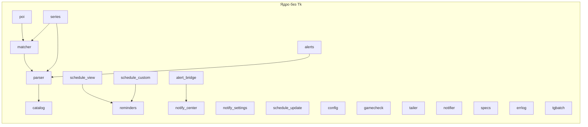
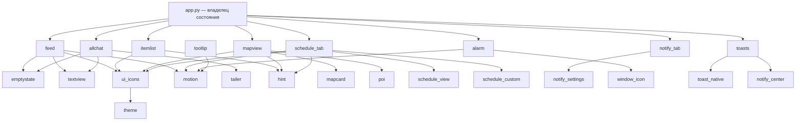
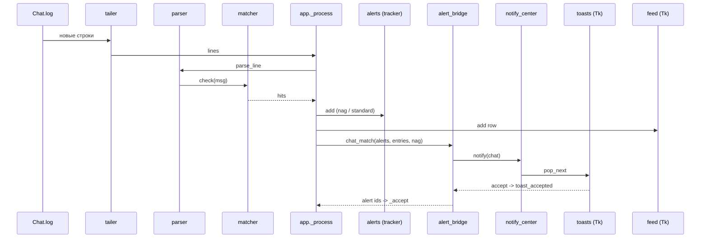
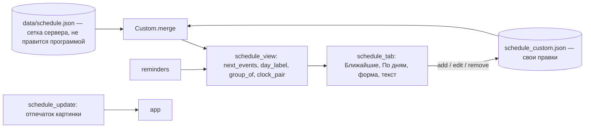

# Карта архитектуры Aion Chat Watcher (13.10.2026)

Построено по реальным импортам `watcher/*.py` (40 модулей). Tk — модуль импортирует `tkinter`.

## 1. Ядра без Tk (переносимы в лаунчер)

## 2. Экраны (Tk) и их зависимости

## 3. Поток данных: от лога до уведомления

## 4. Расписание: данные и правки

## 5. Где состояние и таймеры (Tk)

| Владелец | Состояние | Таймер (after) |
|---|---|---|
| app.py | cfg, tracker, series, матчер, очередь проверки обновления | `_ui_tick`, `_check_reminders` (30 с), `_tick` (poll), проверка расписания (5 с после старта) |
| schedule_tab | events, belled, hidden, custom | `refresh` (30 с), `tick_now` (5 с) |
| toasts | карточки, очередь center | `_poll` (33 мс) |
| alarm | звук по кругу | `_repeat_beep`, `_blink` |
| motion (animate, tween) | — | кадры по запросу, отменяемые |

## 6. Что переносится, что нет

- Переносимо: блоки раздела 1 (около 25 модулей без Tk).
- Не переносится напрямую: раздел 2. Пересобирается в React по макетам.
- Общие точки: `config.json` и `schedule_custom.json` — формат JSON, его читает и лаунчер.

## 7. Размеры (измерено)

- `app.py` 1277 строк — самый большой узел: импортирует 31 модуль.
- `mapview.py` 1020, `theme.py` 858, `schedule_tab.py` 562, `feed.py` 302.
- Ядра без Tk: большинство модулей до 200 строк.
